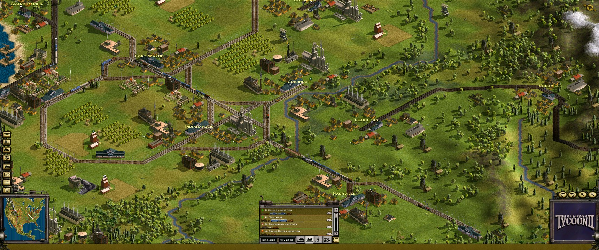

# rt2wide

Widescreen and ultrawide support for **Railroad Tycoon II Platinum** (GOG edition) on modern Windows.

rt2wide is a drop-in `ddraw.dll` that replaces the game's DirectDraw with its own implementation and shows the picture through OpenGL in a borderless full-screen window. In wide mode the game draws at a resolution shaped like your monitor, so on a wide screen you see **more of the map**, not a stretched picture.

*Railroad Tycoon II Platinum drawn at a native 3440x1440: the map fills the screen and the control panel is spread along the bottom.*

Not affiliated with or endorsed by the makers or publishers of Railroad Tycoon II. You need your own copy of the game; nothing from the game is included here.

## Status

Experimental, tested on one machine (3440x1440, Windows 11, NVIDIA).

- By default the game draws at the monitor's own resolution (3440x1440 on the test machine), so the map stays sharp at every zoom level instead of being scaled up. The interface keeps its original pixel size, which makes it smaller on a high-resolution monitor; a lower `height` such as 1080 or 768 makes it larger.
- The in-game map fills the whole screen. The control panel is split into three parts along the bottom (minimap on the left, messages in the centre, logo and zoom/rotate buttons on the right) with the map visible between them, the message ticker runs the full width, and the compass moves to the top-right corner.
- Pop-up dialogs are centred on the wide screen.
- The main menu and other full-screen menu pages are centred at their original 1024x768 size.
- `mode=classic` gives the original 4:3 picture, scaled up with black bars at the sides.

## Requirements

- Railroad Tycoon II Platinum from GOG. The installer checks for this exact `RT2_PLAT.EXE`:
  SHA-256 `510B9E449612E5C6619D0B86CB65C453CEFD26370065F1FD77865760D017E474`.
  The game-specific parts also check the code they touch and switch themselves off on any other build.
- Windows 10 or 11 and an OpenGL-capable GPU. If OpenGL misbehaves, set `renderer=gdi`.

## Build

1. Download [llvm-mingw](https://github.com/mstorsjo/llvm-mingw/releases) (the `msvcrt-x86_64` zip) and unzip it into a `tools\` folder in this repository.
2. Run `BUILD.cmd`. The result is `build\ddraw.dll`.

## Install

Close the game and run `INSTALL.cmd`. It:

1. Takes a one-time backup of the whole game folder and its Windows compatibility settings into `backup\original` (never overwritten).
2. Copies `ddraw.dll` and `rt2wide.ini` into the game folder. No original game file is changed.
3. Removes the "Windows XP SP2" compatibility mode that GOG sets for the game. That mode makes Windows run the game as administrator, with a UAC prompt on every launch. The machine-wide copy of the setting needs admin rights, so you may see one UAC prompt during install. Use `INSTALL.cmd -KeepXpMode` to skip this step.

Then start the game as usual, for example with Play in GOG Galaxy.

The game folder defaults to `C:\Program Files (x86)\GOG Galaxy\Games\Railroad Tycoon II`. Set the `RT2_GAME_DIR` environment variable to use another location.

## Uninstall / roll back

Close the game and run `ROLLBACK.cmd`. It removes the mod's files, restores any original file that changed, and restores the compatibility settings, including the machine-wide one (one UAC prompt). Your save games are kept. `ROLLBACK.cmd -Check` only reports what differs from the backup.

## Settings

`rt2wide.ini` in the game folder:

| Key | Values |
|---|---|
| `[rt2wide] enabled` | `0` passes everything through to Windows' own DirectDraw, as if the mod were not installed |
| `[display] mode` | `wide` (default) or `classic` |
| `[display] width`, `height` | Size the game draws at in wide mode. `height=0` (default) uses the monitor's height, minimum 768; `width=0` derives the width from the monitor shape. A lower `height` gives a larger interface and a softer, scaled-up map |
| `[display] renderer` | `opengl` or `gdi` |
| `[display] scaling` | `aspect`, `integer` or `stretch` |
| `[display] filter` | `linear` or `nearest` |
| `[debug] log` | Writes `rt2wide.log` in the game folder |

## How it works

- `src/ddraw_impl.cpp`: a software implementation of the DirectDraw interfaces the game uses (surfaces, blits, palettes, clipper).
- `src/presenter.cpp`: a borderless window covering the monitor and a render thread that scales the game's frame with OpenGL. It also translates mouse coordinates.
- `src/hooks.cpp`: import-table hooks so the game sees a window of its logical size.
- `src/game.cpp`: game-specific changes, applied in memory only and only after checking the exact code bytes:
  - selects the game's own resizable windowed mode;
  - widens the in-game screen layout (`mainwin.win`) after it loads.
- `re/`: small research tools.
  - `annotate.ps1` and `show.ps1` disassemble and annotate *your own* copy of the exe locally.
  - `tools/windump.cpp` lists the controls in a `.win` UI layout.
  - `run-test.ps1` runs scripted, self-closing test sessions.

## Credits

Addresses, symbol names and file formats were worked out with the help of the documentation in [rrt2-decomp](https://github.com/pedryvo/rrt2-decomp) by pedryvo.

## License

MIT. See [LICENSE](LICENSE).
